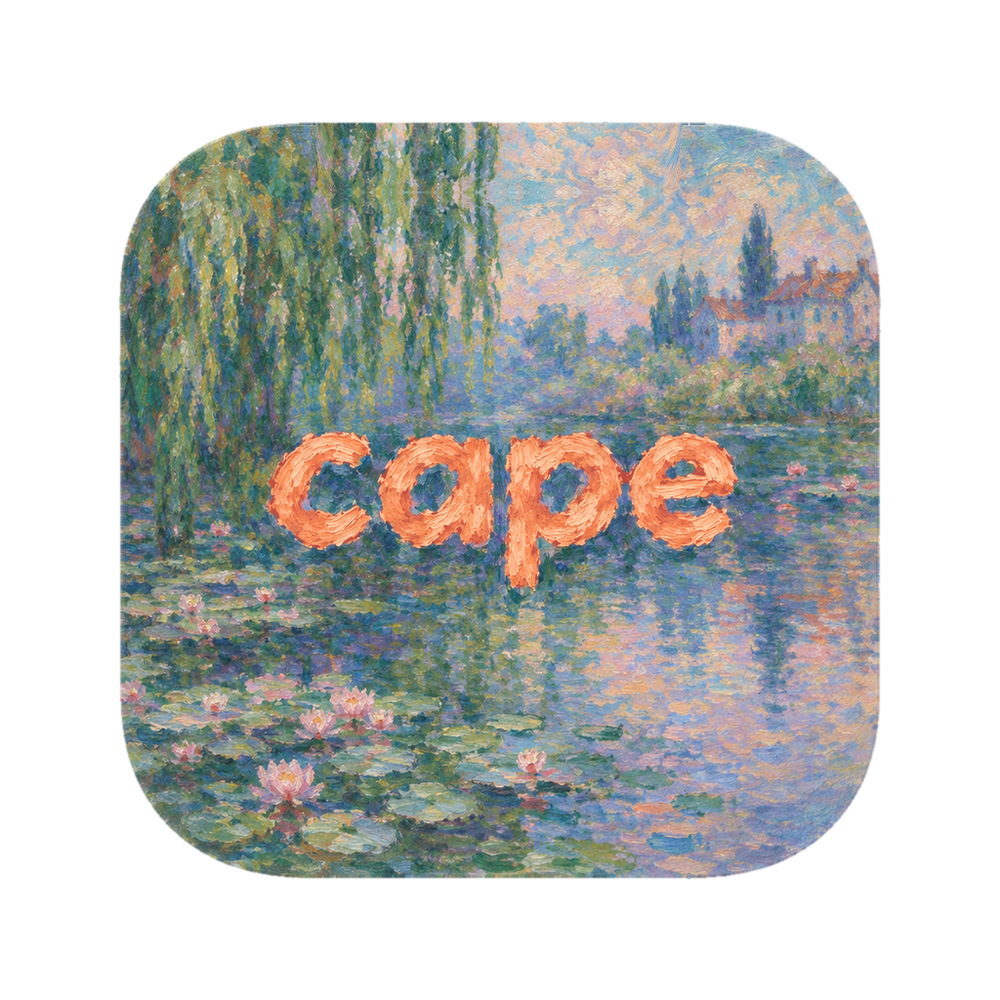
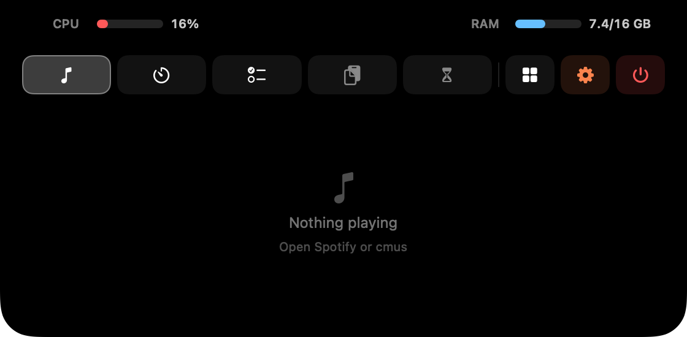
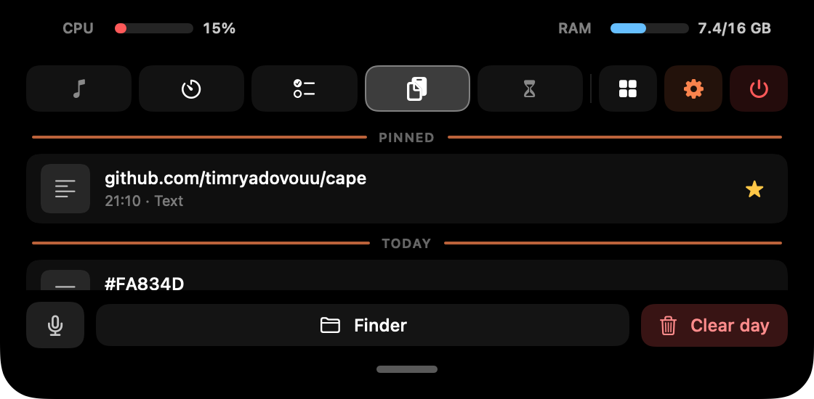
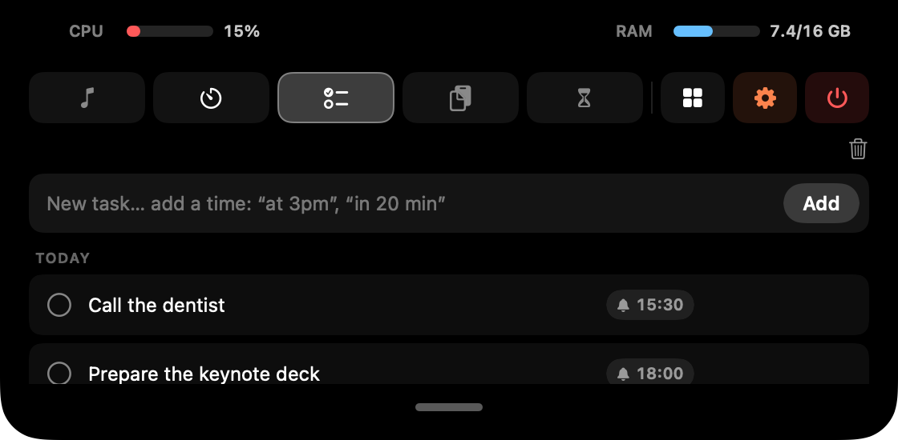
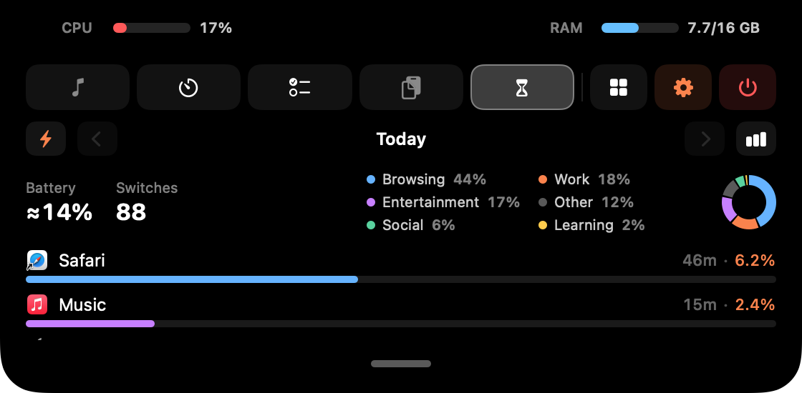

  

<h1 align="center">Cape</h1>

  A small hub in your MacBook's notch: music, clipboard, tasks, dictation and Claude Code.

  <strong>English</strong> · <a href="README.ru.md">Русский</a>

  
  
  

  
  

  
  

## What it does

- **Music**: Spotify and cmus, with covers and seeking. F7–F9 work for cmus too.
- **Clipboard**: everything you copy is kept as files, day by day. Pin, drag out,
  and links from QR codes in screenshots.
- **Tasks with reminders**: write "call mom at 3pm" and it rings at 3pm.
- **Dictation**: hold a key, talk, and the text is on your clipboard. Whisper runs
  on your Mac, nothing goes online.
- **Claude Code**: see which sessions are working or waiting for you, and allow or
  deny tool requests right from the notch.
- **Terminal**: add `; cape done` to a long command and get ✓ or ✗ when it's done.
- **Pomodoro and Screen Time**, including how much battery each app used.
- **Tools**: color picker, a list of running dev servers by port, keyboard cleaning
  mode, reverse mouse wheel.

English or Russian interface. Don't need something? Turn it off and it doesn't run at all.

## Install

Apple Silicon, macOS 13 or newer.

1. Download `Cape.zip` from the [latest release](https://github.com/timryadovouu/cape/releases/latest).
2. Unzip it and move `Cape.app` to Applications.
3. First launch: right-click the app → Open → Open. Cape is signed with my own
   certificate, not Apple's paid one, so macOS asks once.

After that it updates itself. On an Intel Mac, or if you'd rather build it
yourself, see the [guide](docs/guide.md#install).

## More

- [Guide](docs/guide.md): every feature, the settings, how the Claude Code
  integration works, permissions and where your data lives.
- [Changelog](CHANGELOG.md)
- [Security](SECURITY.md)
- [MIT Licence](LICENSE)

Inspired by [macnotch.io](https://macnotch.io).
