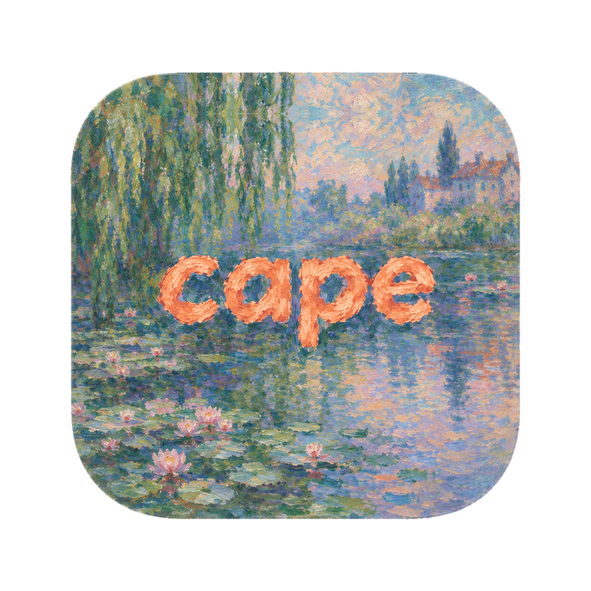
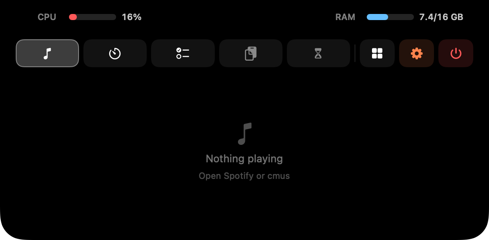
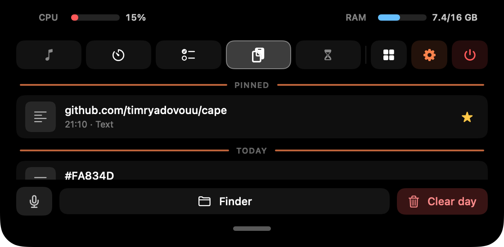
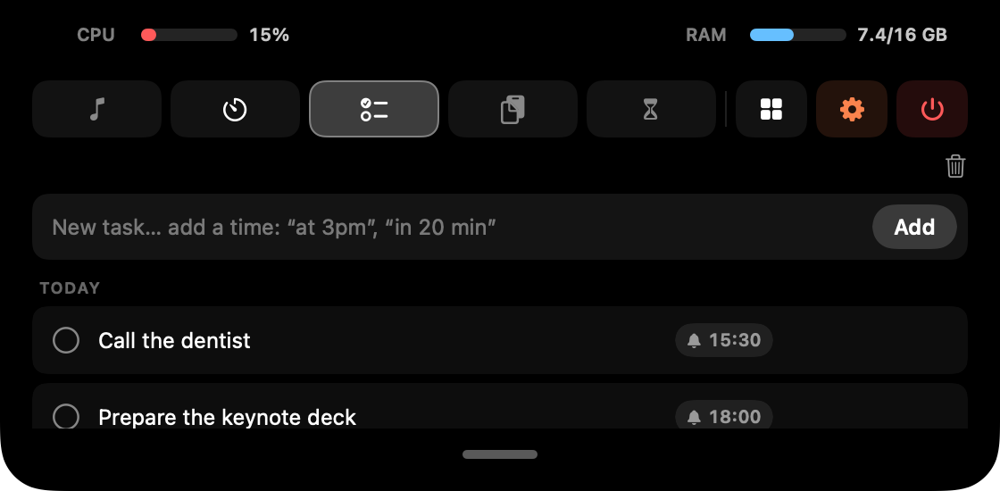
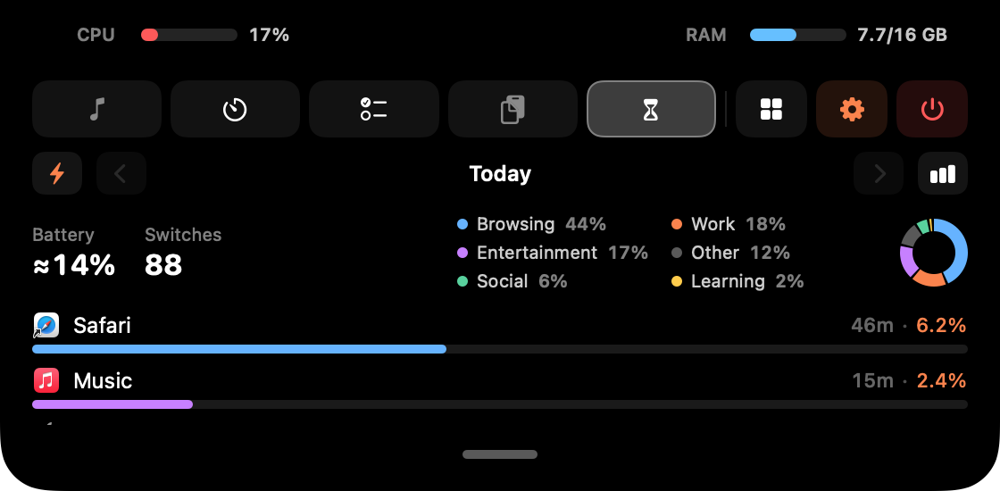

  

<h1 align="center">Cape</h1>

  Маленький хаб в «чёлке» MacBook: музыка, буфер обмена, задачи, диктовка и Claude Code.

  <a href="README.md">English</a> · <strong>Русский</strong>

  
  
  

  
  

  
  

## Что умеет

- **Музыка**: Spotify и cmus, с обложками и перемоткой. F7–F9 работают и с cmus.
- **Буфер обмена**: всё, что копируешь, хранится файлами по дням. Можно закреплять,
  вытаскивать мышкой, а ссылки из QR-кодов на скриншотах попадают туда сами.
- **Задачи с напоминаниями**: пишешь «позвонить маме в 15:00», и в 15:00 звенит.
- **Диктовка**: держишь клавишу, говоришь, и текст уже в буфере. Whisper работает
  на самом Mac, в интернет ничего не уходит.
- **Claude Code**: видно, какие сессии работают и какие ждут тебя, а разрешить или
  запретить команду можно прямо из чёлки.
- **Терминал**: допиши `; cape done` к долгой команде, и по окончании будет ✓ или ✗.
- **Помодоро и Screen Time**, включая расход батареи по приложениям.
- **Инструменты**: пипетка, список запущенных dev-серверов по портам, режим чистки
  клавиатуры, реверс колеса мыши.

Интерфейс на русском или английском. Что-то не нужно? Выключи, и оно вообще не будет работать.

## Установка

Apple Silicon, macOS 13 и новее.

1. Скачай `Cape.zip` из [последнего релиза](https://github.com/timryadovouu/cape/releases/latest).
2. Распакуй и перенеси `Cape.app` в «Программы».
3. Первый запуск: правый клик по приложению → «Открыть» → «Открыть». Cape подписан
   моим собственным сертификатом, а не платным сертификатом Apple, поэтому macOS
   спросит один раз.

Дальше он обновляется сам. Если у тебя Mac на Intel или хочешь собрать сам — смотри
[руководство](docs/guide.ru.md#установка).

## Подробнее

- [Руководство](docs/guide.ru.md): все функции, настройки, как устроена интеграция
  с Claude Code, разрешения и где хранятся данные.
- [Список изменений](CHANGELOG.md)
- [Безопасность](SECURITY.md)
- [MIT Лицензия](LICENSE)

Вдохновлено [macnotch.io](https://macnotch.io).
