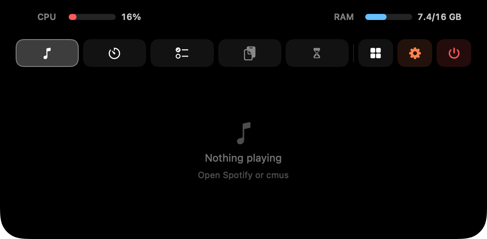
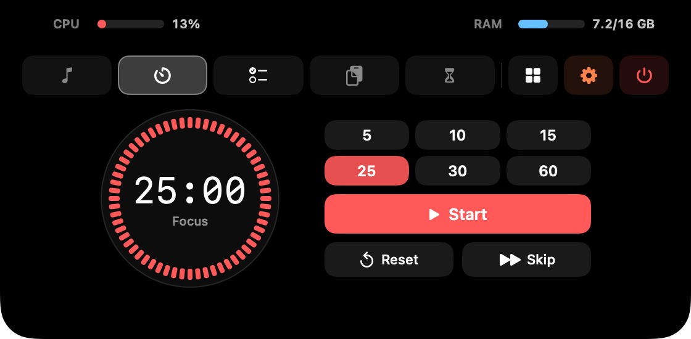
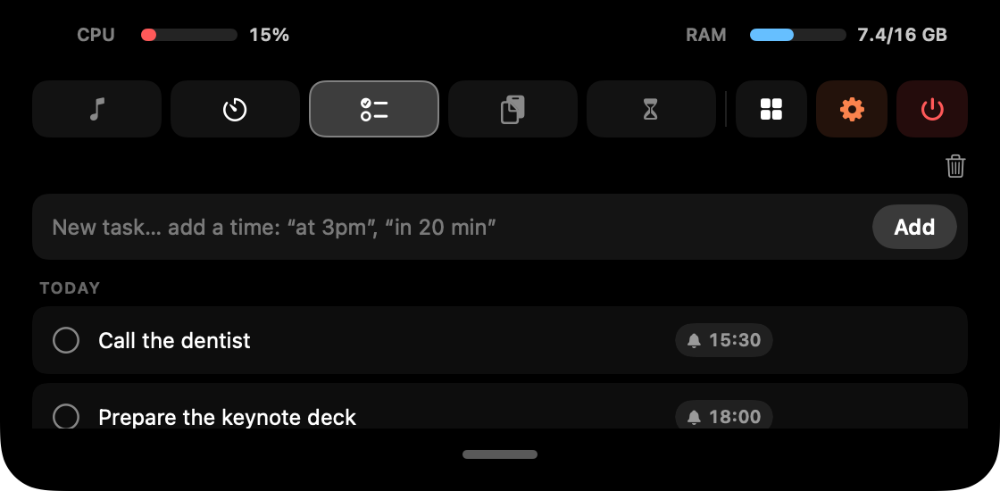
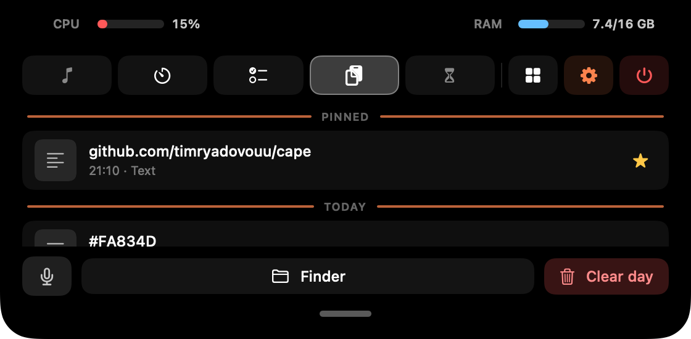
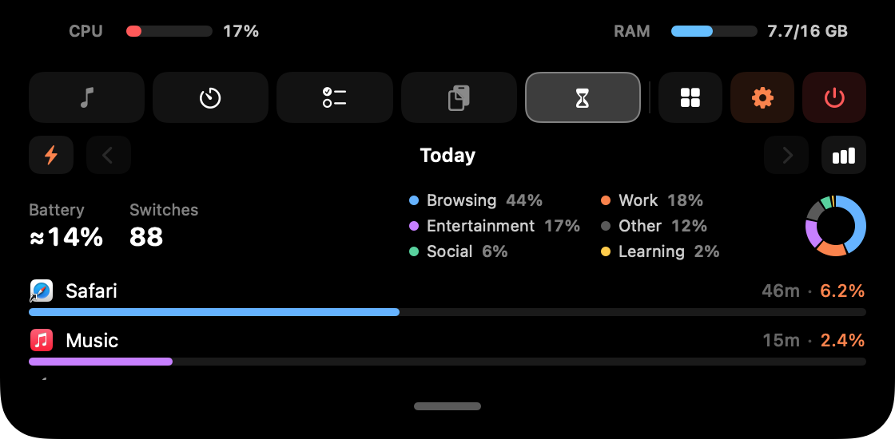
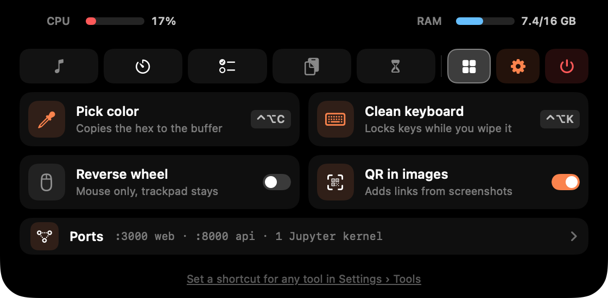
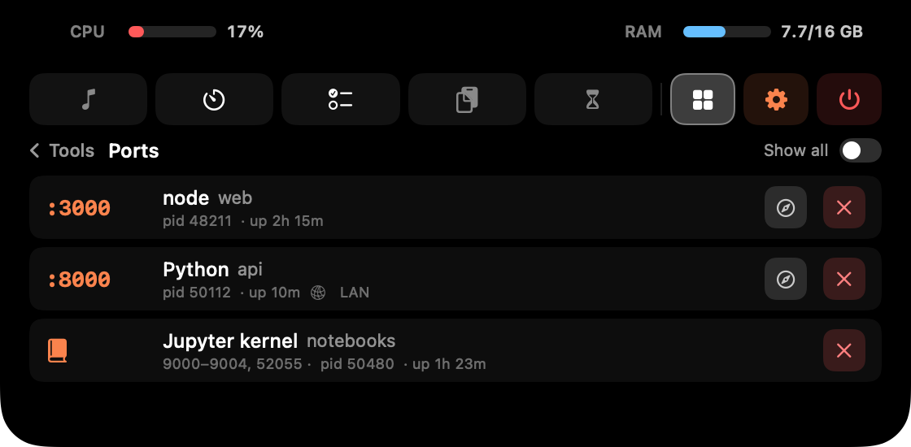
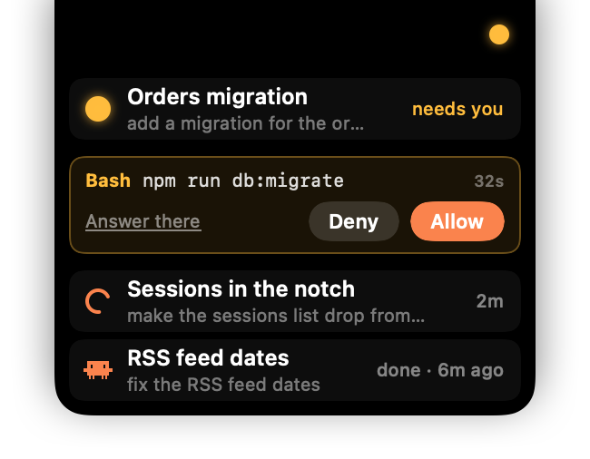

# Cape guide

Everything Cape does, in detail. For the short version, see the [README](../README.md).
По-русски: [guide.ru.md](guide.ru.md).

- [The notch](#the-notch)
- [Tabs](#tabs): [Media](#media) · [Timer](#timer) · [Tasks](#tasks) · [Buffer](#buffer) · [Screen Time](#screen-time)
- [Tools](#tools)
- [Voice dictation](#voice-dictation)
- [Claude Code](#claude-code)
- [Terminal: `cape done`](#terminal-cape-done)
- [Settings](#settings)
- [Install](#install)
- [Updating](#updating)
- [Signing & security](#signing--security)
- [Where data lives](#where-data-lives)
- [Permissions](#permissions)

## The notch

Hover the notch and Cape opens; move away and it closes. Tabs sit on the left of
the icon rail; on the right are **Tools**, the coral **Settings** gear and
**⏻ Quit** (hold it until the ring closes). There's no Dock or menu bar icon (Cape runs as an `LSUIElement` app).

- It stays on the built-in screen, so plugging in a TV or a second display
  doesn't move it. On a Mac without a notch it draws one at the top center.
- English and Russian: Settings › General › Language.
- The app icon is yours to pick in Settings › General: Monet (the default), the
  classic one, Sunrise or Water Lilies. Finder, Launchpad and Spotlight show it too.
- On the first launch a **welcome tour** walks you through the real tabs and
  islands (again any time from Settings › Tips). Its last step lets you switch off
  Pomodoro, Screen Time or the developer extras (Claude Code, Ports, `cape done`).
  Whatever is off doesn't run at all.

**Beside the camera.** While the panel is open, the black areas either side of the
lens show **CPU** on the left (red bar and %) and **RAM** on the right (used / total
GB). RAM "used" is active plus wired memory, the way `htop` and `btop` count it,
not Activity Monitor's higher figure. It's measured only while the panel is open.

**The closed notch** still shows a few things:

- **Left**: an equalizer while music plays (or the album cover, Settings › Notch)
  and a coral ⏸ when paused. Click it to pause or play; rest on it a moment to open
  Media (can be turned off). Short flashes appear here too: a coral clip on copy,
  Focus / Break when the timer changes phase, the picked color, a QR link, a new
  Cape version, and a ⚡ with the battery level when you plug in the charger.
- **Right**: the Claude Code island (see [Claude Code](#claude-code)), the Pomodoro
  countdown (hover it for pause / next / cancel) and a ringing bell when a task is due.
- **Below**: strips that need more room drop down from the brow: the Claude
  sessions list, the dictation model download, and `cape done`.

The islands either side of the camera are the same width, so the brow grows evenly.

## Tabs

The Tasks, Buffer and Screen Time panels have a small grabber at the bottom: tap it
to make the panel taller, tap again to shrink it.

<p align="center">
  
  
</p>
<p align="center">
  
  
</p>

### Media

Now playing for **Spotify** (AppleScript) and **cmus** (`cmus-remote`): cover art,
title and artist, and a coral progress bar you can click or drag to seek. Click the
time on the right to switch between time left and track length.

Covers come from Spotify, or for cmus from a `cover` / `folder` / `front` / `album`
`.jpg` or `.png` in the album folder, or art embedded in MP3/M4A files. Albums
ripped as one file with a cue sheet and tracks in `Disc 1` / `CD2` folders work too.

**Media keys (F7 / F8 / F9) work for cmus.** Cape forwards them, and the track shows
up in Control Center.

### Timer

Pomodoro with focus presets (5 / 10 / 15 / 25 / 30 / 60 min) and a long break every
4 sessions. Break lengths and the completion sound are configurable (any system
sound, ▶ to preview, and whether it plays during a Focus). The countdown shows to
the right of the notch; hover it for pause / next / cancel, or click the time to
pause. A paused timer blinks.

### Tasks

A local to-do list with **reminders**. Write the time into the task: "call mom at
3pm", "in 20 minutes", "tomorrow 9am" (Russian phrases work too). Or click the 🔔 on
a task to open its card: edit the text, pick a quick time (in 1 h, 18:00, tomorrow
9:00, Monday 9:00) or a date and time on the calendar. Enter saves, Esc closes.

When a task is due, a ringing bell slides out to the right of the notch with a
sound; hover it to jump to Tasks. With reminders around, tasks are grouped into
Overdue / Today / Upcoming / No date / Done. Copy, delete, and a trash that keeps
deleted tasks for a while.

### Buffer

A clipboard history kept as **real files**: everything you copy is saved under the
buffer folder in a `YYYY-MM-DD` subfolder per day: text, images and copied files.

- Everything from today and yesterday is listed, under a header per day, with the
  copy time on each entry. Older days fill in up to 20 entries; the rest are in
  the folder (the **Finder** button opens it).
- Click an entry to copy it back, or **drag it out** to Finder or any app.
- Hover for star / copy / delete. **Starred entries pin to the top** and survive
  every cleanup.
- **Clear day** deletes today. Old days are deleted after a set number of days, or
  at the end of each day (Settings › Buffer).
- **Copy an image with a QR code** (a screenshot to the clipboard with ⌃⇧⌘4, say)
  and the code's link appears as its own entry right under it. Can be turned off.
- The **mic** button dictates straight into the buffer (see [Voice dictation](#voice-dictation)).

### Screen Time

Usage tracking on your Mac only. It credits the frontmost app every second and
lists apps with total time and the number of switches; how many apps to show is up
to you (top 5–20 or all).

- A **ring splits the day by category**: Work, Browsing, Social, Entertainment,
  Learning, Other. Click a category to see only its apps.
- **Each day is saved**: browse past days with ◀ / ▶, or see the week as a bar chart.
- **⚡ Battery use**: the same list by how much of a full charge each app used
  ("46m · 6.2%"), with the day's total, the ring and the week chart. It adds up to
  what the battery really lost: an app gets its own work (measured by macOS per
  process, helpers included) plus the screen and the rest of the Mac while it was
  in front, the way the iPhone does it. Time away goes to macOS. Hover a figure for
  the split. Counted on battery only by default.

<p align="center">
  
  
</p>

## Tools

On the **▦ Tools** page at the right of the rail. The one-shot tools can each get a
global shortcut in Settings › Tools (any combination with ⌘, ⌥ or ⌃, no permission
needed).

- **Pick color**: the system magnifier; click any pixel and its hex (`#FA834D`) is
  copied to the clipboard and the buffer, with a swatch flashing in the notch. Esc
  cancels.
- **Clean keyboard**: locks every key (media, volume and brightness included)
  behind a full-screen overlay so you can wipe the keyboard. The trackpad still
  works for the **Done** button; it also unlocks after 2 minutes, on sleep, or when
  the screen locks.
- **Reverse wheel** (a switch): flips a mouse wheel's scroll direction while the
  trackpad keeps natural scrolling, like Scroll Reverser (don't run both). A Magic
  Mouse counts as a trackpad here.
- **QR in images** (a switch): links from QR codes in copied images go to the buffer.
- **Ports**: what's listening on this Mac's TCP ports, one row per process: ports,
  project folder, uptime, and **LAN** when it's reachable from your network. Open
  one in the browser or stop it (click ✕ twice). Dev servers are shown; *Show all*
  adds system services. **Jupyter kernels** are shown as one row with their ports,
  and stopping one warns that the notebook loses its variables. Read with `lsof`,
  only while the page is open. Hide it in Settings › Tools if you don't need it.

<p align="center">
  
</p>

## Voice dictation

The **mic** button in the Buffer tab turns speech into text **on your Mac**: no audio
leaves it. The text lands on the clipboard and in the buffer.

- **Local Whisper** via [WhisperKit](https://github.com/argmaxinc/WhisperKit), on the
  Neural Engine. Pick the model in Settings › Voice (Tiny to Large v3 Turbo; bigger
  is more accurate and uses more memory). It's downloaded once and warmed up at
  launch, so the first dictation is instant.
- **Language and translation**: choose the spoken language (auto-detect can get
  some wrong, Russian for one, so set it) and optionally translate to English.
- **"note …" goes to Tasks**: a transcript starting with *note* / *заметка* becomes
  a task instead (and a time in it becomes a reminder).
- **Global keys** (need Accessibility):
  - **Double-tap** to start / stop: ⌥ Option (either side), right ⌥ only, or ⌃ Control.
  - **Hold to talk**: hold 🌐 Fn and/or right ⌥, release to transcribe. A quick
    press keeps its usual job (the emoji picker, say), and using the key in a chord
    (⌥+letter, Fn+⌫) cancels the recording.
- Without a model the keys don't record. A strip drops down from the notch instead,
  *Dictation needs a model* with a ⬇ button, and shows the download, the first-time
  preparation and *Ready*. ✕ puts it away (and cancels a download in progress).

## Claude Code

On for a new install when Claude Code is on the Mac; the tour's last step and
**Settings › General › Track Claude Code** turn it off. When it's off, Cape doesn't
read anything.

<p align="center">
  
</p>

- A pulsing **coral blob** right of the notch while a session is working: it's lit
  from your prompt until Claude stops, so it really means "thinking now". It turns
  **amber** when a session waits for you.
- **Clawd**: if a session finished while you were in another app, Claude Code's pixel
  critter sits in the island until you look. Click him to jump into that session, or
  just switch to its app. He waves, stomps and blinks every few seconds, looks toward
  the cursor, stretches on a Pomodoro break, dozes off (z z Z) if he waits long, and
  in the end walks home behind the camera. One Clawd however many sessions finish; he stays while any of them waits.
- **Hover the island** and your sessions drop down from the brow: what each one is
  doing (working · needs you · asks you · done), its title and your last prompt.
  Click one to jump into it: in the Claude app, straight into that conversation; a
  terminal comes to the front. A finished session leaves the list once you open it,
  or after 15 minutes. Slide left from the island along the brow to open the full panel.
- **Allow / Deny from the notch.** When Claude asks to run a tool, the request shows
  under its session (`Bash  npm run db:migrate`) with a countdown. Answer it there,
  or pick *Answer there*; unanswered, it goes back to the terminal or app after the
  timeout (1 minute by default). Questions and plan approvals aren't intercepted.
- **Limits**: once you start using your 5-hour window, the Timer tab shows when it
  resets ("Claude limits reset at HH:MM", or "Claude will be ready at HH:MM" when
  you've hit it), and "Claude is ready!" when it frees up.
- Optionally, a **sound when a session finishes**, each one, so with several
  running you hear the first too: any system sound, with switches to stay quiet
  during Focus / Do Not Disturb or while you're in that session's app.

It works wherever Claude Code runs: the terminal and the Claude app's Code tab.

**How it works.** Turning it on merges a few [hooks](https://code.claude.com/docs/en/hooks)
and a `statusLine` command into `~/.claude/settings.json` (backed up to
`settings.json.bak` first; your other settings are kept; Cape updates its entries if
the app moves).

- The hooks append session events to `~/.claude/cape/events.jsonl`, with the app a
  session runs in. That stream drives the island and the list.
- **Permission requests** go through a `PermissionRequest` hook that runs Cape itself
  (a hidden `permission` subcommand). It hands the request to the notch as a file in
  `~/.claude/cape/pending/` and waits for Allow / Deny. If Cape isn't running or the
  feature is off, it steps aside at once and Claude asks as usual.
- To open a session in the Claude app, Cape reads (never writes) the app's own
  session records to find its id and title, and opens its `claude://` link.
- The **reset time** comes from whichever Claude you use:
  - **Terminal**: Cape installs itself as your `statusLine` (a hidden `statusline`
    subcommand), the only place the CLI tells when a window resets. Your terminal
    footer becomes `Opus 4.8 · project · main · ctx 42% · 5h 63% · wk 21%`.
  - **Desktop app**: it never runs a statusLine, so Cape reads the reset time from
    the app's own local storage instead. That's undocumented and may change between
    Claude versions.

Everything stays local; nothing is sent anywhere.

## Terminal: `cape done`

Add `; cape done` to a long command and go do something else. When it ends, a strip
drops down from the notch with ✓ (green) or ✗ (red), the command and how long it
took, plus a sound (Glass / Basso, can be turned off). It leaves after a few seconds
(hovering keeps it), and **a click takes you back to the terminal** (Terminal,
iTerm2, Warp, VS Code…).

```bash
npm run build; cape done
swift test; cape done
```

`cape` is a zsh function, so it sees the exit status of the command before it. Use
`;`, not `&&`, or a failure never reaches it.

**Long commands**: the same strip after any command that ran longer than a threshold
(30 s by default), only while you're in another window, and not for editors, `ssh`,
`claude`, `less`, `top` and the like.

A new install with a `~/.zshrc` gets both turned on (turn them off in the tour's last
step); otherwise install it from **Settings › Terminal**. It adds one line to
`~/.zshrc` (backed up to `~/.zshrc.cape-backup`); open a new terminal tab afterwards.
The function reports by dropping a small file into Cape's data folder.

## Settings

The coral **gear** opens a window with a sidebar of pages, like System Settings. It
remembers its size and the last page.

- **General**: launch at login, Track Claude Code, language, app icon.
- **Tips**: how to use Cape on one page, and *Show the tour*.
- **Updates**: current version, check for updates, install & relaunch, automatic checks.
- **Notch**: the default tab, when to go back to it, opening Media from the music
  island, equalizer or album cover in that island, the charging flash.
- **Tabs**: turn tabs on or off and reorder them. A tab that's off doesn't run: with
  Screen Time off nothing is counted; with the Timer off a running Pomodoro stops.
- **Timer**: break lengths, the end-of-session sound, and whether it plays during a Focus.
- **Tasks**: the reminder sound.
- **Buffer**: folder location, how long to keep days or clear at the end of each day,
  QR codes in copied images.
- **Screen Time**: how long to keep history (1 year by default), how many apps to
  list, battery use on battery only.
- **Voice**: the model (downloaded once, with a delete button), spoken language,
  translate to English, the double-tap key, hold-to-talk keys, preloading at launch.
- **Tools**: a shortcut for each tool, Ports on / off, the reversed mouse wheel.
- **Terminal**: install / remove `cape done`, its sound, and long commands with their threshold.
- **Claude**: Allow / Deny from the notch and its timeout; Clawd (on / off, how long
  he waits, when he falls asleep); a sound when a session finishes.

## Install

macOS 13 or newer.

### Download the app

The prebuilt release is **Apple Silicon only**. On an Intel Mac, build from source.

1. Download **`Cape.zip`** from the [latest release](https://github.com/timryadovouu/cape/releases/latest).
2. Unzip it and drag **`Cape.app`** to **Applications** (the updater needs it there).
3. Cape isn't notarized by Apple (see [Signing & security](#signing--security)), so
   the first launch is blocked. **Right-click the app → Open → Open**, or after a
   blocked double-click go to System Settings → Privacy & Security → Open Anyway.
   You only do this once.

### Build from source

Needs the Xcode Command Line Tools (`xcode-select --install`; full Xcode isn't required).

```bash
git clone https://github.com/timryadovouu/cape.git
cd cape
./build-app.sh
open Cape.app
```

`build-app.sh` compiles, makes the icon and packages **`Cape.app`** in the repo root.
A build you made yourself isn't quarantined, so there's no Gatekeeper prompt. Without
the project's signing certificate it's signed ad-hoc, so macOS asks for permissions
again after each rebuild. `swift run` starts it straight from source.

### After it's running

Hover the notch to open it. To start Cape after a reboot, turn on **Launch at login**
in Settings. To quit, hold the red **⏻** in the open panel until its ring closes.

## Updating

Cape updates itself (since 0.3.0). It checks GitHub Releases at launch and every few
hours, or on demand in Settings › Updates. When there's a new version, a coral dot
appears on the gear, and **Install & Relaunch** downloads it, checks the signature,
swaps it in and restarts. Permissions stay, and there's no Gatekeeper prompt.

Settings and data live in `~/Library/Application Support/Cape/`, not inside the
app, so updates keep them, and a downloaded dictation model too.

Coming from 0.2.0 or older (still called *mac-notch*)? Download `Cape.zip` by hand
once. Cape starts fresh and doesn't import mac-notch's data.

## Signing & security

Releases are signed with the project's own certificate (**"Cape Signing"**), not
Apple's paid Developer ID.

- **Apple doesn't vouch for the author**, hence the one-time right-click → Open.
- **The signature seals the app**: every file is hashed and sealed with the project's
  private key, so changing anything after signing breaks it. The certificate adds no
  code and grants no permissions; it only says who sealed the app.
- **Updates must carry the same signature.** The updater installs a download only if
  it's sealed by the same certificate as the running app.
- **Permissions survive updates**: macOS ties them to the certificate, not to one build.
- **Releases are built in the open**: GitHub Actions builds each one from the tagged
  source, and the logs are public. The private key lives only in my keychain and the
  repository's encrypted secrets.

To report a vulnerability, see [SECURITY.md](../SECURITY.md).

## Where data lives

Everything stays on your Mac:

- Clipboard buffer: `~/Library/Application Support/Cape/localBuffer/`
- Tasks, Screen Time, settings: `~/Library/Application Support/Cape/`
- Dictation models (only if you use Voice): `~/Documents/huggingface/`
- Claude Code tracking (only if on): `~/.claude/cape/`
- `cape done` (only if installed): `~/Library/Application Support/Cape/cape.zsh`
  and one line in `~/.zshrc`

With Claude tracking on, Cape also **reads** (never writes) the reset time from the
desktop app's local storage and its session records.

**Network**: only the update check and download (GitHub Releases), Spotify cover
images, and the one-time dictation model download.

## Permissions

- **Automation**, for Spotify (AppleScript). macOS asks the first time; without it
  the track and controls don't work. cmus needs `cmus-remote` on your `PATH`.
- **Microphone**, for dictation, asked on first use.
- **Accessibility** (System Settings → Privacy & Security), for the dictation keys,
  Clean keyboard and Reverse wheel.
- Pick color, Ports, QR in images, `cape done`, the Claude sessions list and the
  tool shortcuts need no permission.
