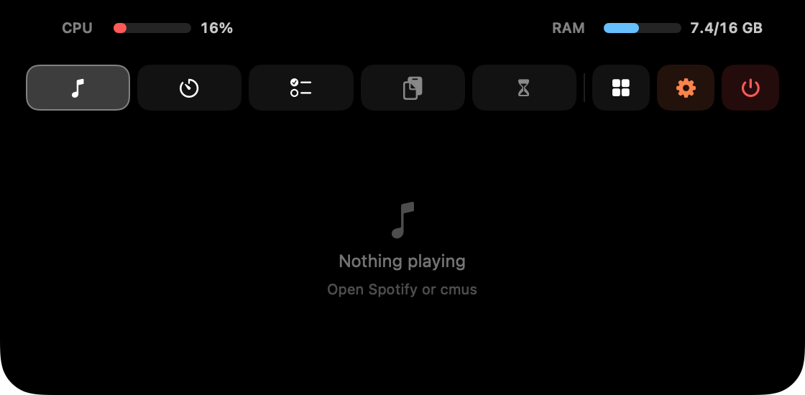
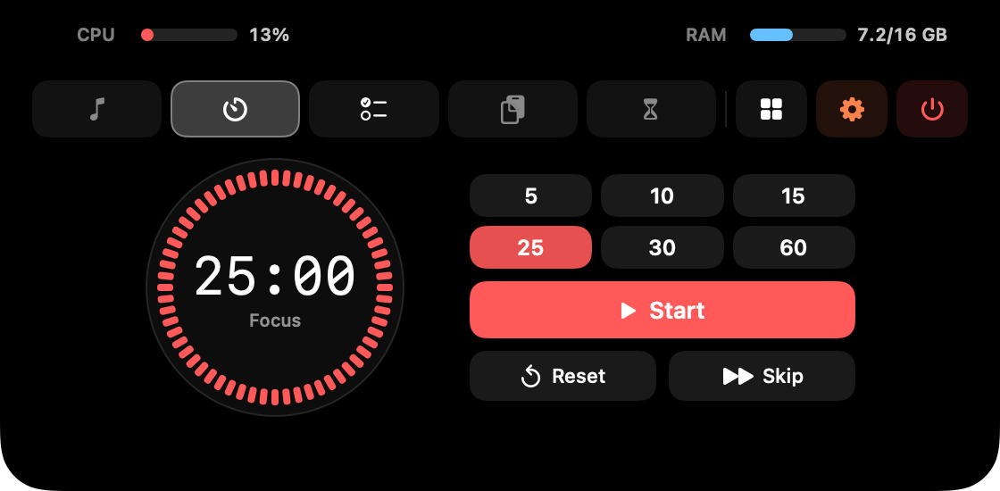
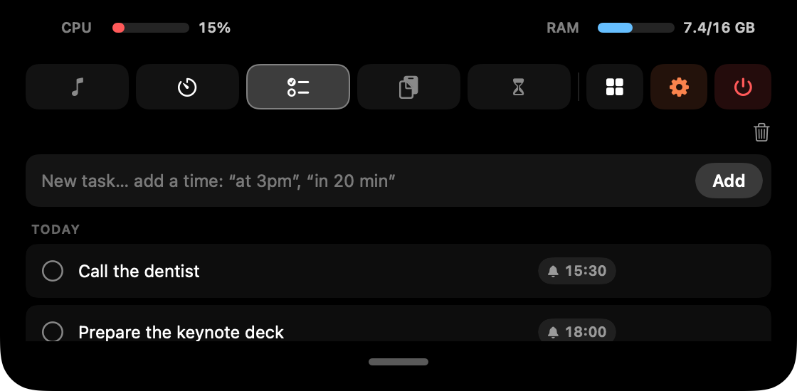
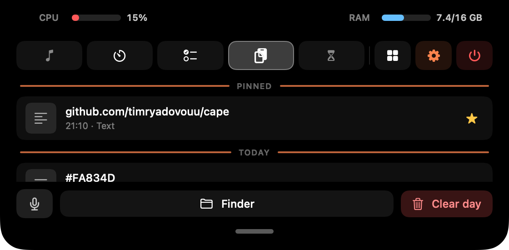
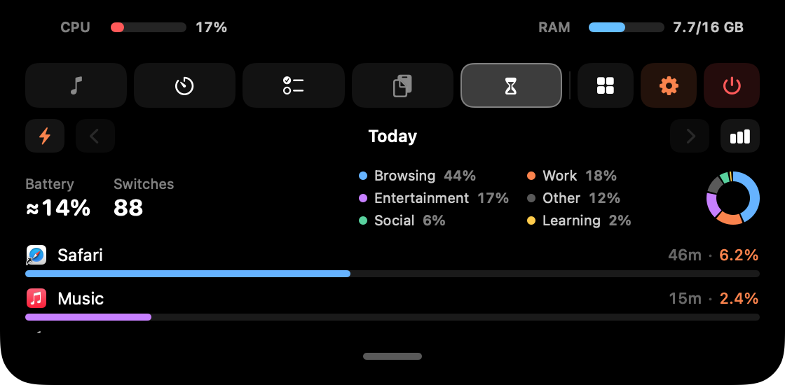
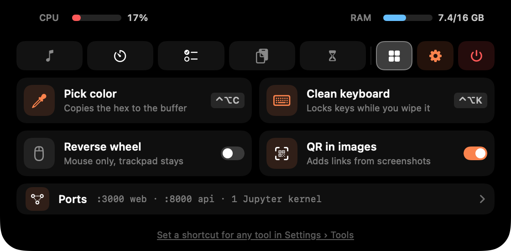
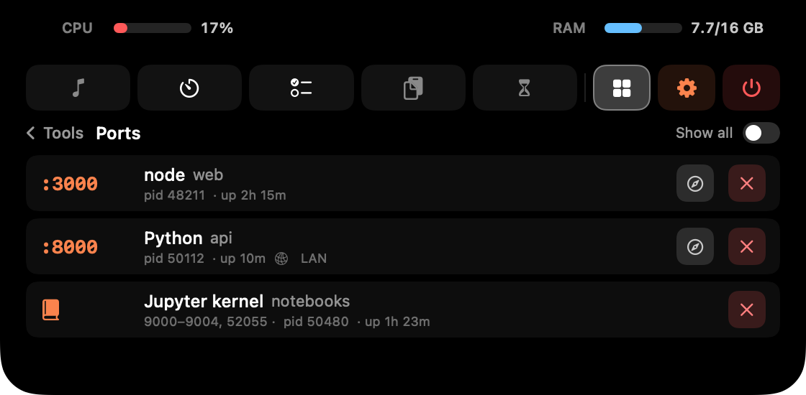
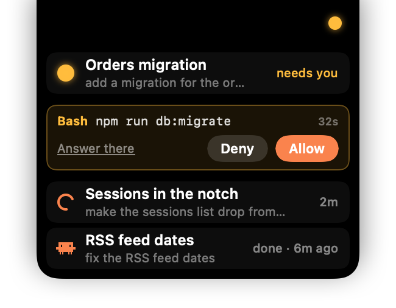

# Руководство по Cape

Всё, что умеет Cape, подробно. Коротко — в [README](../README.ru.md).
In English: [guide.md](guide.md).

- [Чёлка](#чёлка)
- [Вкладки](#вкладки): [Музыка](#музыка) · [Таймер](#таймер) · [Задачи](#задачи) · [Буфер](#буфер) · [Screen Time](#screen-time)
- [Инструменты](#инструменты)
- [Диктовка](#диктовка)
- [Claude Code](#claude-code)
- [Терминал: `cape done`](#терминал-cape-done)
- [Настройки](#настройки)
- [Установка](#установка)
- [Обновление](#обновление)
- [Подпись и безопасность](#подпись-и-безопасность)
- [Где хранятся данные](#где-хранятся-данные)
- [Разрешения](#разрешения)

## Чёлка

Наводишь курсор на чёлку, и Cape раскрывается, уводишь — сворачивается. Вкладки
слева на панели иконок, справа **Инструменты**, коралловая шестерёнка **Настроек**
и **⏻ Выход** (держи, пока не замкнётся кольцо). Иконки в Dock и в строке меню нет (Cape работает как `LSUIElement`).

- Cape живёт на встроенном экране, поэтому телевизор или второй монитор его не
  сдвигают. На Mac без выреза он рисует свою чёлку сверху по центру.
- Русский и английский: Settings › General › Language.
- Иконку можно выбрать в Settings › General: «Моне» (по умолчанию), классическая,
  «Восход» или «Кувшинки». Она меняется и в Finder, Launchpad и Spotlight.
- При первом запуске **знакомство** проводит по настоящим вкладкам и островкам
  (повторить можно в Settings › Tips). На последнем шаге можно выключить Помодоро,
  Screen Time или вещи для разработчиков (Claude Code, Ports, `cape done`).
  Выключенное вообще не работает.

**Рядом с камерой.** Пока панель открыта, чёрные поля по бокам от камеры показывают
**CPU** слева (красная полоска и %) и **RAM** справа (занято / всего, ГБ). «Занято» —
это активная плюс закреплённая память, как считают `htop` и `btop`, а не завышенная
цифра Мониторинга системы. Замеряется только пока панель открыта.

**Свёрнутая чёлка** тоже кое-что показывает:

- **Слева**: эквалайзер, пока играет музыка (или обложку альбома, Settings › Notch),
  и коралловую ⏸ на паузе. Клик — пауза или play; задержишь курсор — откроется
  Музыка (можно выключить). Здесь же короткие вспышки: коралловая скрепка при
  копировании, Фокус / Перерыв при смене фазы таймера, цвет с пипетки, ссылка из QR,
  новая версия Cape и ⚡ с уровнем заряда, когда подключаешь зарядку.
- **Справа**: островок Claude Code (см. [Claude Code](#claude-code)), обратный отсчёт
  Помодоро (наведи — появятся пауза / дальше / отмена) и звенящий колокольчик, когда
  подошло время задачи.
- **Снизу**: то, чему нужно больше места, выпадает плашкой из чёлки: список сессий
  Claude, скачивание модели для диктовки и `cape done`.

Островки по бокам от камеры одной ширины, поэтому чёлка растёт симметрично.

## Вкладки

У Задач, Буфера и Screen Time внизу есть маленькая «хваталка»: нажми, чтобы панель
стала выше, нажми ещё раз — обратно.

<p align="center">
  
  
</p>
<p align="center">
  
  
</p>

### Музыка

Что сейчас играет в **Spotify** (через AppleScript) и **cmus** (через `cmus-remote`):
обложка, название и исполнитель, коралловая полоска прогресса — кликни или потяни,
чтобы перемотать. Клик по времени справа переключает «сколько осталось» и «длину трека».

Обложки берутся из Spotify, а для cmus — из файла `cover` / `folder` / `front` /
`album` (`.jpg` или `.png`) в папке альбома или из картинки внутри MP3/M4A. Альбомы
одним файлом с cue и треки в папках `Disc 1` / `CD2` тоже работают.

**Медиаклавиши (F7 / F8 / F9) работают и с cmus.** Cape передаёт их плееру, а трек
появляется в Пункте управления.

### Таймер

Помодоро с пресетами фокуса (5 / 10 / 15 / 25 / 30 / 60 мин) и длинным перерывом
каждые 4 сессии. Длину перерывов и звук окончания можно настроить (любой системный
звук, ▶ — прослушать, и играть ли его во время режима «Фокусирование»). Отсчёт
виден справа от чёлки; наведи — появятся пауза / дальше / отмена, или кликни по
времени, чтобы поставить на паузу. Таймер на паузе мигает.

### Задачи

Список дел на твоём Mac с **напоминаниями**. Пиши время прямо в задаче: «позвонить
маме в 15:00», «через 20 минут», «завтра в 9» (английские фразы тоже понимает). Или
нажми 🔔 у задачи — откроется её карточка: поправить текст, выбрать быстрое время
(через час, 18:00, завтра 9:00, понедельник 9:00) или дату и время в календаре.
Enter сохраняет, Esc закрывает.

Когда подходит время, справа от чёлки выезжает звенящий колокольчик со звуком;
наведи на него — откроются Задачи. Если есть напоминания, задачи делятся на
Просрочено / Сегодня / Скоро / Без даты / Готово. Можно копировать и удалять, а
удалённые задачи какое-то время лежат в корзине.

### Буфер

История буфера обмена **настоящими файлами**: всё, что копируешь, сохраняется в
папку буфера, в подпапку `ГГГГ-ММ-ДД` на каждый день — текст, картинки и
скопированные файлы.

- За сегодня и вчера показывается всё, с заголовком на каждый день и временем у
  каждой записи. Более старые дни добивают список до 20 записей; остальное лежит
  в папке (её открывает кнопка **Finder**).
- Клик по записи копирует её обратно, а ещё её можно **вытащить мышкой** в Finder
  или любое приложение.
- При наведении — звёздочка / копировать / удалить. **Отмеченные звёздочкой
  закрепляются сверху** и переживают любую очистку.
- **Clear day** удаляет сегодняшний день. Старые дни удаляются через заданное
  число дней или в конце каждого дня (Settings › Buffer).
- **Скопируй картинку с QR-кодом** (например, скриншот в буфер через ⌃⇧⌘4), и ссылка
  из кода появится отдельной записью прямо под ней. Можно выключить.
- Кнопка **микрофона** диктует прямо в буфер (см. [Диктовка](#диктовка)).

### Screen Time

Учёт времени только на твоём Mac. Каждую секунду засчитывает приложение на переднем
плане и показывает список приложений с общим временем и числом переключений;
сколько приложений показывать — решаешь сам (топ 5–20 или все).

- **Кольцо делит день по категориям**: работа, браузер, соцсети, развлечения,
  обучение, другое. Кликни категорию — останутся только её приложения.
- **Каждый день сохраняется**: листай прошлые дни через ◀ / ▶ или смотри неделю
  столбиками.
- **⚡ Расход батареи**: тот же список по тому, сколько полного заряда съело каждое
  приложение («46 мин · 6,2%»), с итогом за день, кольцом и графиком недели. В
  сумме ровно столько, сколько потеряла батарея: приложению достаётся его
  собственная работа (macOS меряет её по процессам, вспомогательные засчитываются
  своему приложению) плюс экран и остальной Mac, пока оно было на переднем плане,
  как в iPhone. Время, когда тебя нет, уходит в macOS. Наведи на цифру — покажет
  разбивку. По умолчанию считается только работа от батареи.

<p align="center">
  
  
</p>

## Инструменты

На странице **▦ Инструменты** справа на панели иконок. Разовым инструментам можно
назначить глобальный шорткат в Settings › Tools (любое сочетание с ⌘, ⌥ или ⌃,
разрешения не нужны).

- **Пипетка**: системная лупа; кликни по любому пикселю, и его HEX (`#FA834D`)
  скопируется в буфер обмена и в Буфер, а в чёлке мигнёт образец цвета. Esc — отмена.
- **Чистка клавиатуры**: блокирует все клавиши (включая медиа, громкость и яркость)
  за полноэкранной заставкой, чтобы протереть клавиатуру. Трекпад работает для
  кнопки **Done**; ещё она снимается сама через 2 минуты, при сне или блокировке экрана.
- **Реверс колеса** (переключатель): разворачивает прокрутку колеса мыши, а трекпад
  остаётся «естественным», как в Scroll Reverser (не запускай их вместе). Magic Mouse
  здесь считается трекпадом.
- **QR в картинках** (переключатель): ссылки из QR-кодов в скопированных картинках
  попадают в Буфер.
- **Ports**: что слушает TCP-порты на этом Mac, по строке на процесс: порты, папка
  проекта, время работы и **LAN**, если доступно из домашней сети. Можно открыть в
  браузере или остановить (дважды ✕). Показываются dev-серверы; *Show all* добавляет
  системные службы. **Ядра Jupyter** показываются одной строкой с портами, а при
  остановке Cape предупредит, что ноутбук потеряет переменные. Читается через
  `lsof` и только пока страница открыта. Не нужно — скрой в Settings › Tools.

<p align="center">
  
</p>

## Диктовка

Кнопка **микрофона** во вкладке Буфер превращает речь в текст **на самом Mac**: звук
никуда не уходит. Текст попадает в буфер обмена и в Буфер.

- **Локальный Whisper** через [WhisperKit](https://github.com/argmaxinc/WhisperKit),
  на Neural Engine. Модель выбирается в Settings › Voice (от Tiny до Large v3 Turbo;
  чем больше, тем точнее и тем больше памяти). Скачивается один раз и прогревается
  при запуске, поэтому первая диктовка сразу быстрая.
- **Язык и перевод**: выбери язык речи (автоопределение путает некоторые, например
  русский, так что лучше указать) и при желании перевод на английский.
- **«заметка …» уходит в Задачи**: текст, который начинается со слова *заметка* /
  *note*, становится задачей (а время в нём — напоминанием).
- **Глобальные клавиши** (нужен Универсальный доступ):
  - **Двойное нажатие** — старт / стоп: ⌥ Option (любой), только правый ⌥ или ⌃ Control.
  - **Рация**: держи 🌐 Fn и/или правый ⌥, отпусти — текст распознан. Короткое
    нажатие работает как обычно (например, открывает эмодзи), а сочетание с клавишей
    (⌥+буква, Fn+⌫) отменяет запись.
- Без модели клавиши не пишут. Вместо этого из чёлки выпадает плашка «Для диктовки
  нужна модель» с кнопкой ⬇ и показывает скачивание, первую подготовку и «Готово».
  ✕ убирает её (и отменяет скачивание, если оно идёт).

## Claude Code

У нового Cape включается сам, если на Mac есть Claude Code; выключить можно на
последнем шаге знакомства или в **Settings › General › Track Claude Code**. Когда
выключено, Cape ничего не читает.

<p align="center">
  
</p>

- **Коралловая клякса** справа от чёлки, пока сессия работает: горит от твоего
  запроса до остановки Claude, то есть правда значит «думает прямо сейчас».
  Становится **янтарной**, когда сессия ждёт тебя.
- **Clawd**: если сессия закончилась, пока ты был в другом приложении, в островке
  сидит пиксельный зверёк Claude Code и ждёт, пока посмотришь. Клик по нему — сразу в
  эту сессию, или просто переключись в её приложение. Каждые несколько секунд машет,
  топает и моргает, смотрит на курсор, потягивается в перерыв Помодоро, заждавшись —
  засыпает (z z Z), а в конце уходит домой за камеру. Clawd один, сколько бы
  сессий ни закончилось: он остаётся, пока ждёт хоть одна.
- **Наведи на островок**, и из чёлки выпадет список сессий: что каждая делает
  (работает · ждёт тебя · спрашивает · готово), её название и твой последний запрос.
  Клик — переход в сессию: в приложении Claude сразу в этот диалог, терминал
  выходит на передний план. Завершённая уходит из списка, когда её откроешь, или
  через 15 минут. Проведи курсором с островка влево по чёлке — откроется вся панель.
- **«Да / Нет» прямо в чёлке.** Когда Claude просит запустить команду, запрос
  появляется под его сессией (`Bash  npm run db:migrate`) с обратным отсчётом.
  Ответь там или выбери *Answer there*; без ответа запрос вернётся в терминал или
  приложение по таймауту (по умолчанию минута). Вопросы и согласование планов не
  перехватываются.
- **Лимиты**: как только начинаешь тратить 5-часовое окно, во вкладке Таймер видно,
  когда оно сбросится («Claude limits reset at HH:MM», или «Claude will be ready at
  HH:MM», если лимит исчерпан), а потом «Claude is ready!».
- По желанию — **звук, когда сессия закончила**, каждая, так что при нескольких
  сразу слышно и первую: любой системный, с переключателями «молчать в режиме
  Фокусирование / Не беспокоить» и «молчать, пока ты в приложении этой сессии».

Работает везде, где запущен Claude Code: в терминале и во вкладке Code приложения Claude.

**Как это устроено.** При включении Cape добавляет несколько
[хуков](https://code.claude.com/docs/en/hooks) и команду `statusLine` в
`~/.claude/settings.json` (сначала копия в `settings.json.bak`; остальные настройки
не трогает; если приложение переехало, Cape сам обновит свои записи).

- Хуки дописывают события сессий в `~/.claude/cape/events.jsonl`, вместе с
  приложением, в котором идёт сессия. По этому потоку работают островок и список.
- **Запросы разрешений** идут через хук `PermissionRequest`, который запускает сам
  Cape (скрытая подкоманда `permission`). Он передаёт запрос в чёлку файлом в
  `~/.claude/cape/pending/` и ждёт «Да / Нет». Если Cape не запущен или функция
  выключена, он сразу отходит в сторону, и Claude спрашивает как обычно.
- Чтобы открыть сессию в приложении Claude, Cape читает (никогда не пишет) записи
  сессий самого приложения, находит её id и название и открывает ссылку `claude://`.
- **Время сброса лимита** берётся оттуда, где ты работаешь с Claude:
  - **Терминал**: Cape ставит себя твоим `statusLine` (скрытая подкоманда
    `statusline`) — только там CLI сообщает, когда сбросится окно. Нижняя строка
    терминала становится такой: `Opus 4.8 · project · main · ctx 42% · 5h 63% · wk 21%`.
  - **Приложение Claude**: оно не запускает statusLine, поэтому Cape читает время
    сброса из его локального хранилища. Это не документировано и может измениться
    в новых версиях Claude.

Всё остаётся на твоём Mac, никуда ничего не отправляется.

## Терминал: `cape done`

Допиши `; cape done` к долгой команде и занимайся своими делами. Когда она
закончится, из чёлки выпадет плашка с ✓ (зелёной) или ✗ (красной), командой и
временем выполнения, плюс звук (Glass / Basso, можно выключить). Через несколько
секунд она уходит (наведённый курсор её держит), а **клик возвращает в терминал**
(Terminal, iTerm2, Warp, VS Code…).

```bash
npm run build; cape done
swift test; cape done
```

`cape` — это функция zsh, поэтому она видит код завершения предыдущей команды.
Ставь `;`, а не `&&`, иначе до неё не дойдёт ошибка.

**Долгие команды**: такая же плашка после любой команды дольше порога (по умолчанию
30 секунд), только когда ты в другом окне и не для редакторов, `ssh`, `claude`,
`less`, `top` и подобных.

Если при первом запуске у тебя есть `~/.zshrc`, обе функции включены сразу
(выключить — на последнем шаге знакомства); иначе установка — в **Settings ›
Terminal**. Cape добавляет одну строку в `~/.zshrc` (с копией в
`~/.zshrc.cape-backup`); после этого открой новую вкладку терминала. Функция
сообщает о себе, кладя маленький файл в папку данных Cape.

## Настройки

Коралловая **шестерёнка** открывает окно с разделами слева, как Системные настройки.
Оно запоминает свой размер и последний раздел.

- **General**: запуск при входе, Track Claude Code, язык, иконка приложения.
- **Tips**: как пользоваться Cape, на одной странице, и *Show the tour*.
- **Updates**: текущая версия, проверка обновлений, установка с перезапуском,
  автоматическая проверка.
- **Notch**: вкладка по умолчанию, когда к ней возвращаться, открытие Музыки с
  островка, эквалайзер или обложка в этом островке, вспышка при зарядке.
- **Tabs**: включить, выключить и переставить вкладки. Выключенная вкладка не
  работает: без Screen Time ничего не считается, без Таймера идущий Помодоро останавливается.
- **Timer**: длина перерывов, звук окончания и играть ли его во время Фокусирования.
- **Tasks**: звук напоминания.
- **Buffer**: где лежит папка, сколько хранить дни или чистить в конце каждого дня,
  QR-коды в скопированных картинках.
- **Screen Time**: сколько хранить историю (по умолчанию год), сколько приложений
  показывать, считать ли расход только от батареи.
- **Voice**: модель (скачивается один раз, есть кнопка удаления), язык речи, перевод
  на английский, клавиша двойного нажатия, клавиши рации, загрузка модели при запуске.
- **Tools**: шорткат для каждого инструмента, Ports вкл / выкл, реверс колеса мыши.
- **Terminal**: установить / удалить `cape done`, его звук и долгие команды с порогом.
- **Claude**: «Да / Нет» в чёлке и его таймаут; Clawd (вкл / выкл, сколько ждёт,
  когда засыпает); звук, когда сессия закончила.

## Установка

macOS 13 и новее.

### Скачать готовое

Готовая сборка — только для **Apple Silicon**. На Mac с Intel собери из исходников.

1. Скачай **`Cape.zip`** из [последнего релиза](https://github.com/timryadovouu/cape/releases/latest).
2. Распакуй и перенеси **`Cape.app`** в **«Программы»** (обновления ставятся только оттуда).
3. Cape не заверен Apple (см. [Подпись и безопасность](#подпись-и-безопасность)),
   поэтому первый запуск заблокирован. **Правый клик по приложению → «Открыть» →
   «Открыть»**, или после заблокированного двойного клика: Системные настройки →
   Конфиденциальность и безопасность → «Всё равно открыть». Это нужно один раз.

### Собрать из исходников

Нужны Xcode Command Line Tools (`xcode-select --install`; полный Xcode не нужен).

```bash
git clone https://github.com/timryadovouu/cape.git
cd cape
./build-app.sh
open Cape.app
```

`build-app.sh` компилирует, делает иконку и собирает **`Cape.app`** в корне
репозитория. Собранное у себя не помечается карантином, поэтому Gatekeeper не
спрашивает. Без сертификата проекта сборка подписывается ad-hoc, и macOS заново
спрашивает разрешения после каждой пересборки. `swift run` запускает прямо из исходников.

### После запуска

Наведи курсор на чёлку, чтобы её открыть. Чтобы Cape запускался после перезагрузки,
включи **Launch at login** в Настройках. Чтобы выйти, держи красную **⏻** в открытой панели, пока не замкнётся кольцо.

## Обновление

Cape обновляется сам (с версии 0.3.0). Он проверяет GitHub Releases при запуске и
раз в несколько часов, или по кнопке в Settings › Updates. Когда выходит новая
версия, на шестерёнке появляется коралловая точка, а **Install & Relaunch** скачивает
её, проверяет подпись, подменяет приложение и перезапускает. Разрешения остаются,
Gatekeeper не спрашивает.

Настройки и данные лежат в `~/Library/Application Support/Cape/`, а не внутри
приложения, поэтому обновления их не трогают, как и скачанную модель для диктовки.

Если у тебя 0.2.0 или старше (она ещё называлась *mac-notch*) — один раз скачай
`Cape.zip` вручную. Cape начнёт с чистого листа и не перенесёт данные mac-notch.

## Подпись и безопасность

Релизы подписаны собственным сертификатом проекта (**«Cape Signing»**), а не платным
Developer ID от Apple.

- **Apple не подтверждает, кто автор** — отсюда один раз правый клик → «Открыть».
- **Подпись — это пломба**: каждый файл приложения посчитан и запечатан закрытым
  ключом проекта, поэтому любое изменение после подписи её ломает. Сертификат не
  добавляет код и не даёт никаких прав; он только говорит, кто запечатал.
- **Обновления должны быть с той же подписью.** Cape ставит скачанное, только если
  оно запечатано тем же сертификатом, что и запущенное приложение.
- **Разрешения переживают обновления**: macOS привязывает их к сертификату, а не к
  одной сборке.
- **Релизы собираются в открытую**: каждый собирает GitHub Actions из исходников по
  тегу, логи публичные. Закрытый ключ есть только в моей связке ключей и в
  зашифрованных секретах репозитория.

Как сообщить об уязвимости — в [SECURITY.md](../SECURITY.md).

## Где хранятся данные

Всё остаётся на твоём Mac:

- Буфер: `~/Library/Application Support/Cape/localBuffer/`
- Задачи, Screen Time, настройки: `~/Library/Application Support/Cape/`
- Модели для диктовки (только если пользуешься): `~/Documents/huggingface/`
- Слежение за Claude Code (только если включено): `~/.claude/cape/`
- `cape done` (только если установлен): `~/Library/Application Support/Cape/cape.zsh`
  и одна строка в `~/.zshrc`

Когда слежение за Claude включено, Cape ещё **читает** (никогда не пишет) время
сброса лимита из локального хранилища приложения Claude и записи его сессий.

**Интернет**: только проверка и скачивание обновлений (GitHub Releases), обложки
Spotify и разовое скачивание модели для диктовки.

## Разрешения

- **Автоматизация** — для Spotify (AppleScript). macOS спросит в первый раз; без неё
  трек и управление не работают. Для cmus нужен `cmus-remote` в `PATH`.
- **Микрофон** — для диктовки, спрашивается при первом использовании.
- **Универсальный доступ** (Системные настройки → Конфиденциальность и
  безопасность) — для клавиш диктовки, чистки клавиатуры и реверса колеса.
- Пипетке, Ports, QR в картинках, `cape done`, списку сессий Claude и шорткатам
  инструментов разрешения не нужны.
